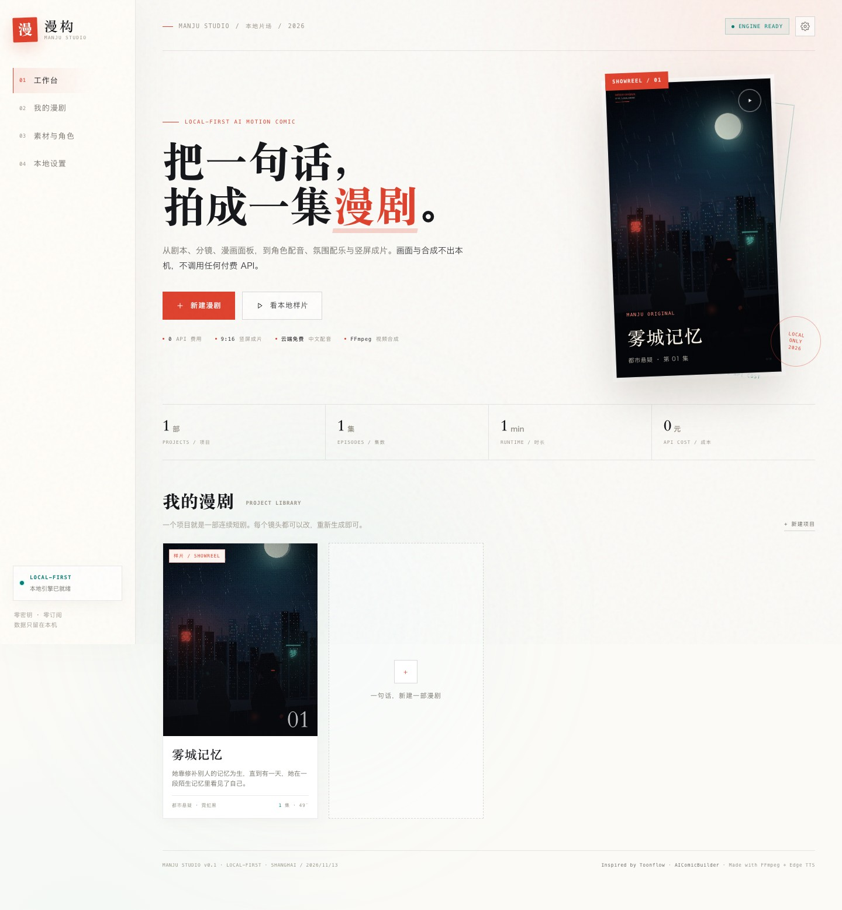
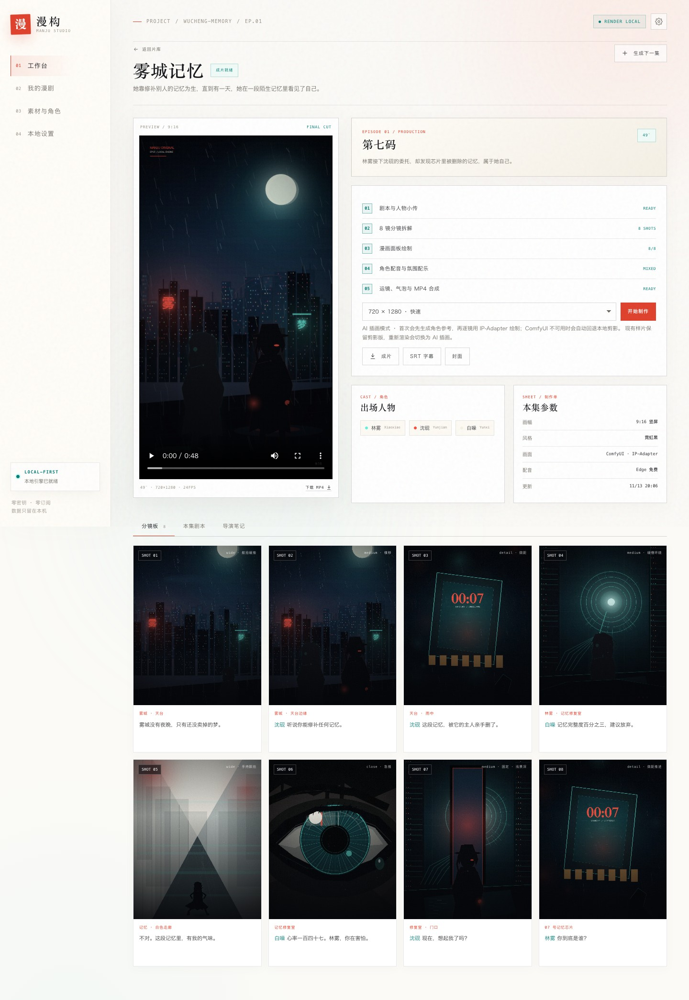
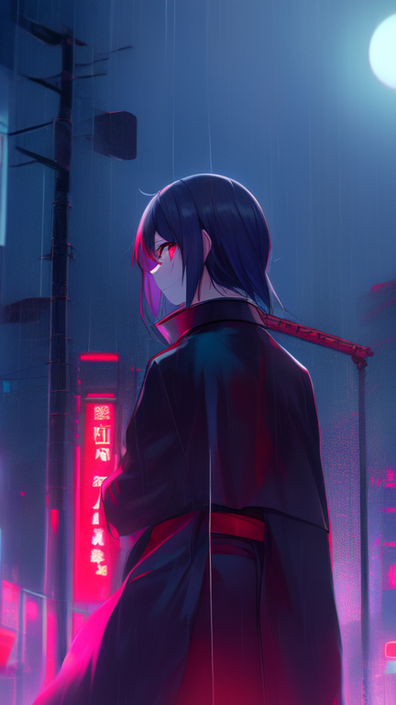
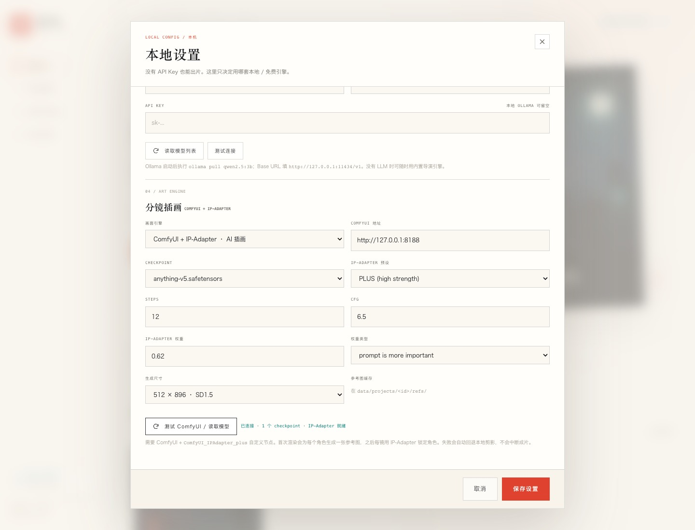

# 漫构 MANJU STUDIO

> 一句话，生成一集漫剧。**免费、本地优先、零 API 密钥。**

漫构是一套面向竖屏短剧 / 动态漫的本地生成系统。输入一句故事创意，系统会自动完成：

**剧本 → 人物小传 → 分镜 → 漫画面板 → 中文配音 → 氛围配乐与音效 → 运镜 / 气泡 / 字幕 → MP4 成片**

画面、配乐与合成全部在本地完成；默认配音使用免费的 Edge TTS，也可切换为完全离线。不登录、不订阅、不依赖付费模型。样片《雾城记忆》已经生成好，打开即可播放。





---

## 1. 快速开始

环境要求：macOS / Linux / Windows，Python 3.10+。**不需要安装 FFmpeg**（`imageio-ffmpeg` 会带一个可执行文件），也不需要 API Key。

```bash
git clone https://github.com/wangxin9528/manju-studio.git
cd manju-studio
./start.sh
```

- GitHub：https://github.com/wangxin9528/manju-studio
- 中文项目页：[漫剧生成.md](漫剧生成.md)
- Release：https://github.com/wangxin9528/manju-studio/releases/tag/v0.1.0

首次启动会创建 `.venv` 并安装依赖，然后打开：

**http://127.0.0.1:8787**

停止服务：在终端按 `Ctrl+C`。如果端口已被占用，脚本会直接打开已有服务。

手动启动：

```bash
python3 -m venv .venv
.venv/bin/pip install -r requirements.txt
.venv/bin/uvicorn app.main:app --host 127.0.0.1 --port 8787
```

> 只有一部样片时可以直接点「开始制作」，约 30 秒即可重出一版 720p 成片。

### 可选 AI 环境

```bash
./scripts/setup_ollama.sh     # Ollama + qwen2.5:3b（约 2GB）
./scripts/setup_comfyui.sh    # ComfyUI + SD1.5 + IP-Adapter（约 7GB）
```

只下载模型（已经装过 ComfyUI）：

```bash
./scripts/download_models.sh
./scripts/download_models.sh --check   # 只检查是否齐全
```

模型权重不随仓库分发，且不适用本仓库的 MIT 许可证。

---

## 2. 你会得到什么

- **一部 40–70 秒的竖屏漫剧**：720×1280 / 24fps，H.264 + AAC。
- **8 个镜头**：景别、运镜、漫画面板、角色剪影、霓虹 / 雨 / 网点 / 颗粒。
- **角色配音**：Edge TTS 免费中文声线（晓晓 / 云健 / 云希…），断网时自动回退 macOS `say`。
- **原创配乐与音效**：Python + NumPy 程序化生成，无版权素材，自动压在人声下方。
- **漫画对白气泡 + 旁白字幕**：按台词时长自动排版、渐入渐出。
- **可编辑分镜**：点任意镜头改旁白、台词、情绪、景别、运镜和 AI 插画提示词，保存后重新生成。
- **可选 Ollama 写剧本**：本地 3B 模型重写标题、钩子、台词与节奏；结构由导演引擎兜底。
- **可选 ComfyUI + IP-Adapter**：为角色先生成参考图，再逐镜出插画，锁定脸、发型与服装。
- **多集连续剧**：一键生成下一集，最多 12 集。
- **导出**：MP4、SRT 字幕、封面 JPG。

### 样片

《雾城记忆》第一集「第七码」：在记忆可以买卖的雾城，记忆修复师林雾接到一单生意——修复一段被抹去的记忆，而记忆里的主角，正是她自己。

- 成片：`data/projects/wucheng-memory/ep01/final.mp4`
- 字幕：`data/projects/wucheng-memory/ep01/subtitles.srt`
- 封面：`data/projects/wucheng-memory/ep01/cover.jpg`

方便直接查看的副本在：

- `output/wucheng_memory_ep01.mp4`
- `output/wucheng_memory_ep01.srt`
- `output/wucheng_memory_cover.jpg`

---

## 3. 为什么是这套组合？

我调研并实际跑过 GitHub 上的几个成熟项目：

| 项目 | 定位 | 结论 |
|---|---|---|
| [Toonflow](https://github.com/HBAI-Ltd/Toonflow-app) | 无限画布 AI 短剧 / 漫剧平台（MIT） | 功能最完整，但需要自己接图片 / 视频模型；本机 8GB M2 跑本地视频扩散不现实 |
| [LocalMiniDrama](https://github.com/xuanyustudio/LocalMiniDrama) | 本地 AI 短剧 / 漫剧（MIT） | 工程完整，但图片 / 视频仍依赖通义、火山、可灵等付费 API |
| [AIComicBuilder](https://github.com/LingyiChen-AI/AIComicBuilder) | 剧本 → 分镜 → 关键帧 → 视频（Apache-2.0） | 需要 OpenAI / Gemini / Kling / Seedance 等供应商 |
| [LumenX](https://github.com/alibaba/lumenx) | 阿里开源 AI 短漫剧（MIT） | 依赖 DashScope 等云端模型 |

这些项目解决的是「调度模型」的问题，不是「没有模型时如何出片」的问题。本机是 **M2 / 8GB**，本地 SD / 视频模型要么跑不动，要么一条 5 秒镜头要等很久。

所以漫构做了一个更务实的选择：

1. **不把成片质量押在视频扩散上。** 漫剧本来就允许有限动画——分镜、运镜、气泡、配音、音效就能讲故事。
2. **用程序化美术保证角色一致性和零成本。** 人物是符号化剪影，靠发型、风衣、礼帽、围巾、声线和霓虹描边锚定；跨镜头不会「换脸」。
3. **只复用真正免费、可商用的开源组件**：FastAPI、Pillow、NumPy、FFmpeg、Edge TTS。
4. **升级接口已经接好**：设置里可以启用 Ollama / OpenAI 兼容文本模型；画面引擎可以切换到 ComfyUI + IP-Adapter，失败自动回退剪影。

这不是一个「模型套壳」，而是一条真正能在本机跑通、可控、可编辑的漫剧生产线。

---

## 4. 生成链路

```text
一句创意
   │
   ├─ 剧本引擎（内置 / 可选 Ollama）
   │    ├─ 内置导演：人物小传、8 镜结构、分镜、旁白、钩子
   │    └─ Ollama：在稳定结构上重写标题、台词与钩子
   │
   ├─ 画面引擎（二选一）
   │    ├─ 内置漫画面板（Pillow）：场景 / 剪影 / 雨 / 网点 / 角标
   │    └─ ComfyUI + IP-Adapter：角色参考图 → 逐镜插画
   │         └─ 连接失败 / 单镜失败 → 自动回退内置剪影
   │
   ├─ 配音（Edge TTS / macOS say）
   │    └─ 按角色与情绪映射声线、语速、音高
   │
   ├─ 声音设计（NumPy）
   │    ├─ 氛围配乐：小调 Pad / 拨弦 / 低频 / 鼓点
   │    └─ 音效：雨、心跳、警报、故障、冲击
   │
   └─ 合成（Pillow + FFmpeg）
        ├─ Ken Burns 运镜 / 镜头切换
        ├─ 漫画气泡 / 旁白字幕 / 片头 HUD / 片尾卡
        └─ 720p / 1080p MP4 + SRT + 封面
```

### 数据目录

```text
data/
├── config.json                  # 本地设置
├── cache/                       # TTS / 调试缓存（可删）
└── projects/
    └── wucheng-memory/
        ├── project.json         # 项目、角色、分镜、时间线
        ├── refs/                # AI 角色参考图（ComfyUI 模式）
        └── ep01/
            ├── art/             # 8 张漫画面板
            ├── voice/           # 每句配音 wav
            ├── mix.wav          # 最终混音
            ├── timeline.json    # 时间线
            ├── subtitles.srt
            ├── cover.jpg
            └── final.mp4
```

所有数据都在本机，删除项目目录即彻底删除。

---

## 5. 配置

打开右上角齿轮 →「本地设置」。

### 5.1 配音

- **Edge TTS**（默认）：免费在线，声线最好，首次生成需要联网。
- **macOS say**：完全离线。只有婷婷 / 美佳两个中文声线可用，系统会自动给男声做低音处理。
- **自动回退**：Edge 失败时自动用本机语音，不会卡死整个项目。

### 5.2 Ollama 写剧本

系统支持任何 OpenAI 兼容接口，但首推 Ollama。仓库内提供了一个不需要 Homebrew 的安装脚本：

```bash
./scripts/setup_ollama.sh
```

它会下载 Ollama 到 `.tools/`、启动本地服务，并拉取 `qwen2.5:3b`（约 2GB，只需一次）。之后：

1. 打开「本地设置」→ 03 STORY MODEL
2. 启用 LLM 写剧本
3. Base URL：`http://127.0.0.1:11434/v1`
4. Model：`qwen2.5:3b`
5. 点「读取模型列表」和「测试连接」，保存

创建项目时勾选「调用本地大模型写剧本」即可。工作方式是**混合生成**：内置导演负责可靠的 8 镜结构，Ollama 在此基础上重写标题、钩子和台词。这样即使 3B 模型输出不稳，也不会得到一部没有对白的幻灯片。失败或超时会自动回退内置剧本。

> 在 8GB M2 上，3B 是甜点；7B 会更慢甚至超时，不建议作为默认。没有 Ollama 也完全可用。

### 5.3 ComfyUI + IP-Adapter 分镜插画

**开发机已经实际装好并跑通了**（这些文件在 `.tools/` 下，已加入 `.gitignore`，不会出现在 GitHub / 发布包里）：

- ComfyUI 0.45.0
- ComfyUI_IPAdapter_plus
- AnythingV5（SD1.5 动漫底模，2.1GB）
- IP-Adapter Plus SD15（94MB）
- CLIP-ViT-H（2.4GB）
- 独立 Python 环境 `.tools/comfyui-venv`

全新 clone 时先运行：

```bash
./scripts/setup_comfyui.sh
# 或：已经装好 ComfyUI，只下载模型
./scripts/download_models.sh
```

启动/重启 ComfyUI：

```bash
./scripts/start_comfyui.sh
```

`start.sh` 会在检测到本机 ComfyUI 时自动启动它；如果端口 8188 已有服务则跳过。开发机的画面引擎已切到 ComfyUI，checkpoint 为 `anything-v5.safetensors`；公开仓库的示例配置仍默认 `builtin`，你需要在设置里自己切换。

系统会先为每个角色生成一张参考图，再用 IP-Adapter 把参考图带进每个镜头。首次参考图和逐镜生成会明显慢于剪影模式。

前置组件（换机器时）：

- [ComfyUI](https://github.com/comfyanonymous/ComfyUI)
- [ComfyUI_IPAdapter_plus](https://github.com/cubiq/ComfyUI_IPAdapter_plus)
- 一个 SD1.5 动漫 checkpoint（例如 MeinaMix）
- IP-Adapter Plus SD15 模型 + CLIP-ViT-H（放进 ComfyUI 对应目录）

启动 ComfyUI：

```bash
python main.py --listen 127.0.0.1 --port 8188
```

在漫构设置里：

1. 画面引擎选「ComfyUI + IP-Adapter」
2. 地址填 `http://127.0.0.1:8188`
3. 点「测试 ComfyUI / 读取模型」，选择 checkpoint
4. IP-Adapter 预设选 `PLUS (high strength)`；显存紧张时用 `STANDARD (medium strength)`
5. 保存并重新生成本集

首次渲染会先生成角色参考图（缓存在 `data/projects/<id>/refs/`），之后逐镜生成。更换 checkpoint 后如果想重做参考图，删除该项目的 `refs/` 目录再渲染即可。

**真实测试结果（2026-11-13，M2 / 8GB）**

- 角色参考图：512×768，8 steps，约 82 秒（含首次加载模型）
- IP-Adapter 分镜图：512×768，8 steps，约 56–100 秒
- 单镜成片（含配音、配乐、字幕、运镜、MP4）：约 68 秒
- 单镜测试视频：[ai_art_one_shot.mp4](output/ai_art_one_shot.mp4)
- 真实测试静帧：[rooftop-ipadapter.jpg](docs/comfyui-test/rooftop-ipadapter.jpg)
- 角色参考图：[character-reference.png](docs/comfyui-test/character-reference.png)



真实设置页（ComfyUI 已连接 / checkpoint 已识别）：



8GB M2 可以跑，但不要指望批量速度：8 镜 12 steps 大约需要 15–25 分钟。先用 1 镜验证，再跑整集。SD1.5 在复杂双人镜头里仍可能换脸/换发型，IP-Adapter 权重、参考图和提示词需要微调。

**重要：** 模型文件在 `.tools/` 下，体积约 4.6GB，不随 Git 分发。换机器运行 `./scripts/setup_comfyui.sh` 或 `./scripts/download_models.sh` 即可。仓库里的 mock ComfyUI 仍保留用于开发测试。

**验证状态**

- Ollama `qwen2.5:3b`：已真实安装、启动并完成剧本重写测试（约 40 秒/集）。
- ComfyUI + IP-Adapter：已安装真实 AnythingV5 / IP-Adapter Plus / CLIP-ViT-H，真实跑通参考图、分镜图、单镜成片和失败回退。

开发时可以用仓库自带的 mock ComfyUI 验证整条链路（返回的是占位图，不是真实 AI 画）：

```bash
.venv/bin/uvicorn scripts.mock_comfyui:app --port 8188
# 设置：画面引擎 ComfyUI + IP-Adapter，地址 http://127.0.0.1:8188
# checkpoint 检测后会出现 mock_anime.safetensors
```

### 5.4 画幅与分辨率

- 成片固定 9:16 竖屏。
- 预览/快速：720×1280。
- 高清：1080×1920（合成时间约为 720p 的 2 倍）。

---

## 6. Agent 接口 / Skill

系统自带一个可被 Claude Code、Codex、OpenClaw 等 Agent 调用的本地 API，也提供了技能模板：

```text
skills/manju-studio/SKILL.md
```

把该目录复制到你的 Agent skills 目录，或直接按里面的 HTTP 流程调用：

```text
GET  /api/projects
POST /api/projects
GET  /api/projects/{id}
PATCH /api/projects/{id}/episodes/{ep}/shots/{shot}
POST /api/projects/{id}/episodes/{ep}/render
GET  /api/jobs/{job_id}
GET  /api/comfy/status
GET  /api/llm/models
GET  /api/settings
PUT  /api/settings
```

所有接口都在 `http://127.0.0.1:8787`，无鉴权，只监听本机。

---

## 7. 常见问题

**Q：为什么样片画面是剪影，不是 AI 插画？**  
A：样片默认使用零依赖的内置剪影引擎，保证 8GB 机器也能秒级出片。想要 AI 插画，在设置里切到 ComfyUI + IP-Adapter 即可；失败会自动回退剪影。

**Q：能接 Stable Diffusion / ComfyUI 吗？**  
A：已经接好。设置里切到 ComfyUI + IP-Adapter，配好 ComfyUI 地址、checkpoint 和 IP-Adapter 预设即可。连接失败会自动回退本地剪影，不会让整集渲染失败。真实出图需要你自己安装 ComfyUI 和 SD 模型。

**Q：能商用吗？**  
A：本项目代码 MIT。依赖库和服务的许可证请自行核对：Edge TTS 为 LGPLv3，FFmpeg 为 LGPL/GPL（取决于构建），Pillow 为 MIT-CMU，imageio-ffmpeg 为 BSD-2。Edge TTS 调用的是微软在线服务，商用前请确认其条款。

**Q：为什么第一次生成有点慢？**  
A：内置剪影模式下，要生成 8 张面板、十几条配音、整轨配乐，再逐帧编码 1000 帧左右；720p 通常 30–60 秒。ComfyUI 模式下每张插画还需要模型推理时间，首次还要先生成角色参考图。

**Q：没有网络能用吗？**  
A：可以。把设置里的配音引擎改成 macOS say，剧本用内置引擎，画面与合成都在本机。只有 Edge TTS 需要网络。

**Q：怎么备份/迁移？**  
A：复制整个 `data/projects/` 目录即可；项目 JSON 与素材在一起。

---

## 8. 已知限制与下一步

- 默认人物仍是剪影风格；没有面部表情动画和口型同步。
- 内置编剧是确定性模板；Ollama 3B 写出的台词是可用草稿，不是专业编剧水准，建议在分镜编辑器里改。
- ComfyUI 模式的自带工作流面向 IPAdapter Plus；不同版本的 ComfyUI / 自定义节点可能需要调整。
- 8GB M2 跑 SD1.5 已实测可用，但速度慢；8 镜整集约 15–25 分钟，建议先用单镜/低步数验证。
- 角色参考图按项目缓存；换 checkpoint 后需要手动删除 `refs/` 重新生成。
- 视频是 2.5D 运镜，不是逐帧生成。
- 没有背景音乐素材库，配乐是算法生成的氛围轨。

推荐升级顺序：

1. 有 GPU / 另一台机器时，把 ComfyUI 地址指过去，用 SDXL + IP-Adapter 提升画面。
2. 接本地 TTS（CosyVoice / Kokoro）替换 Edge TTS，彻底离线。
3. 需要镜头级视频时，再把关键帧送入可灵 / Seedance / Wan 等 I2V 模型。
4. 用更大的 Ollama 模型（7B+）重写台词，但需要更多内存和时间。

---

## 9. 开源与致谢

本系统复用了以下开源组件：

- [FastAPI](https://github.com/fastapi/fastapi) — MIT
- [Pillow](https://github.com/python-pillow/Pillow) — MIT-CMU
- [NumPy](https://github.com/numpy/numpy) — BSD-3
- [FFmpeg](https://ffmpeg.org/) / [imageio-ffmpeg](https://github.com/imageio/imageio-ffmpeg) — LGPL / BSD-2
- [edge-tts](https://github.com/rany2/edge-tts) — LGPLv3
- [Uvicorn](https://github.com/encode/uvicorn) — BSD-3
- [Ollama](https://github.com/ollama/ollama) — MIT（可选运行时）
- [ComfyUI](https://github.com/comfyanonymous/ComfyUI) — GPL-3.0（可选外部服务）
- [ComfyUI_IPAdapter_plus](https://github.com/cubiq/ComfyUI_IPAdapter_plus) — GPL-3.0（可选自定义节点）

产品与流程参考（未直接复制代码）：

- [Toonflow](https://github.com/HBAI-Ltd/Toonflow-app) — MIT
- [LocalMiniDrama](https://github.com/xuanyustudio/LocalMiniDrama) — MIT
- [AIComicBuilder](https://github.com/LingyiChen-AI/AIComicBuilder) — Apache-2.0
- [LumenX](https://github.com/alibaba/lumenx) — MIT
- [Awesome 漫剧](https://github.com/TWO-ICE/awesome-manyu) — 项目索引

本项目代码：[MIT](LICENSE)。

---

**漫构 MANJU STUDIO** · 让灵感成为看得见的故事。


---

## 10. 仓库、发布包与贡献

- 版本：[VERSION](VERSION) · 变更记录：[CHANGELOG.md](CHANGELOG.md)
- 发布包：`dist/manju-studio-0.1.0.zip` + `dist/SHA256SUMS`
- 发布包只包含代码、样片、文档和安装脚本；**不包含** `.tools/`、`.venv/`、模型权重、本机日志或配置
- Git tag：`v0.1.0`
- 开发与贡献：[CONTRIBUTING.md](CONTRIBUTING.md)
- 安全策略：[SECURITY.md](SECURITY.md)
- 代码许可证：[MIT](LICENSE)；第三方组件与模型权重分别遵循各自许可证

公开仓库：[wangxin9528/manju-studio](https://github.com/wangxin9528/manju-studio)  
Release：[v0.1.0](https://github.com/wangxin9528/manju-studio/releases/tag/v0.1.0)

发布包可以用仓库里的 `dist/` 直接上传到 GitHub Releases；模型下载脚本让使用者自己拉取 AnythingV5 / IP-Adapter，不把 4.6GB 权重塞进 Git 历史。
